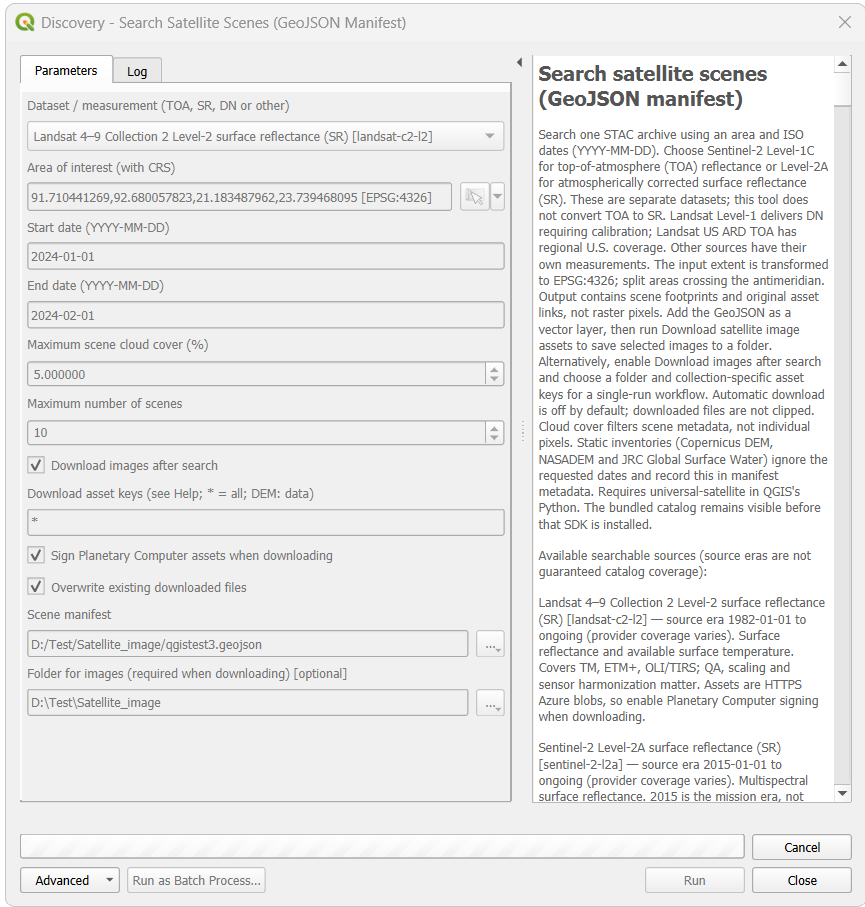
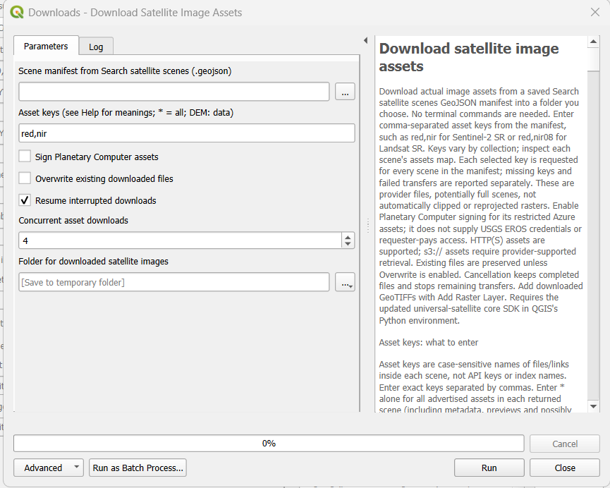
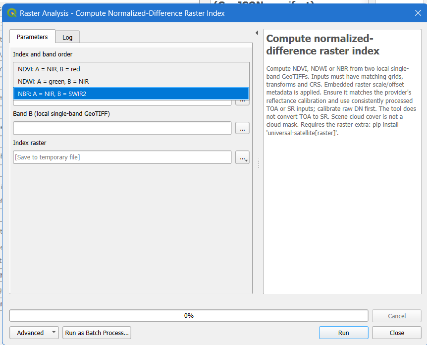
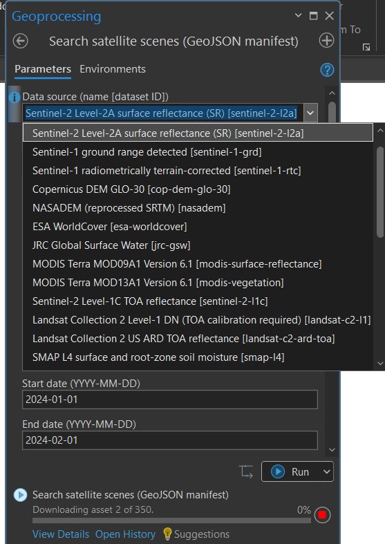
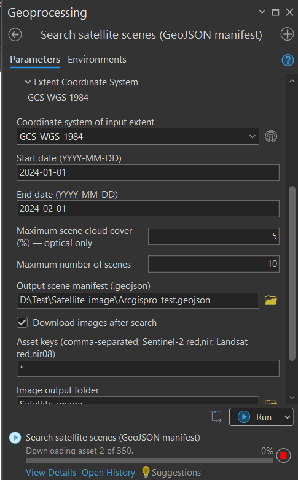

# Universal Satellite

Search satellite and environmental data, download files, and calculate spectral
indices using **QGIS, ArcGIS Pro, Python or Node/TypeScript**.

Includes **30 searchable data sources**, **280 spectral formulas**, resumable
downloads, polygon clipping and environmental point profiles. Provider access
requirements and coverage vary.

## 1. Install

Download and extract the [latest project ZIP](https://github.com/Bipul-roy-AI/Universal-Satellite/archive/refs/heads/main.zip).

**Install the Python core first.** In the Python shell environment used by your
GIS application, run the following command. Replace the example path with your
extracted folder; run this in a terminal, not at a Python `>>>` prompt:

```bat
python -m pip install --upgrade "D:\Test\Universal-Satellite-main"
```

For QGIS on Windows, use its **OSGeo4W Shell**. For ArcGIS Pro, use the **Python
Command Prompt for your cloned environment**. Python 3.10 or newer is required.
For raster processing dependencies, see the [GIS installation guide](docs/gis.md).

Then install the interface:

| Application | Download | What to do |
| --- | --- | --- |
| QGIS | [Plugin ZIP](gis/qgis/universal_satellite_qgis.zip) | Plugins → Manage and Install Plugins → Install from ZIP |
| ArcGIS Pro | [Toolbox ZIP](gis/arcgis/universal_satellite_arcgis.zip) | Extract, then add `UniversalSatellite.pyt` through Catalog → Toolboxes |

On GitHub, use **Download raw file** to save a ZIP. **Restart your GIS after
installation.** When updating, update both the interface ZIP and the Python core.
QGIS and ArcGIS Pro need separate core installations in their own environments.

## 2. Search and download

1. Open **Search satellite scenes (GeoJSON manifest)**.
2. Choose a dataset, area of interest and date range. Start with **1–2 scenes**.
3. Choose where to save the `.geojson` manifest. It contains footprints and file links.
4. Enable **Download images after search**, select asset keys and an output folder.
5. Enable **Sign Planetary Computer assets** when using a Planetary Computer source.
6. Run the tool and read its final download summary. Add downloaded rasters to your map.

Already have a manifest? Open **Download satellite image assets** to reuse it
without searching again. Downloading images does **not** calculate indices.

## 3. Choose asset keys

An **asset key** is the name of a file within a scene. It is not an API password.
Enter exact, case-sensitive names separated by commas.

| What you want | Dataset | Enter |
| --- | --- | --- |
| Red band only — a small first test | Sentinel-2 L2A or Landsat L2 | `red` |
| Visible colours + near infrared | Sentinel-2 L2A | `red,green,blue,nir` |
| Visible colours + near infrared | Landsat L2 | `red,green,blue,nir08` |
| Elevation | Copernicus DEM or USGS 3DEP | `data` |
| Elevation | NASADEM | `elevation` |
| Land-cover classes | ESA WorldCover | `map` |
| Every advertised asset in each returned scene | Any scene with assets | `*` |

**`*` includes metadata and previews, not just images.** It does not remove the
scene limit. Exact keys vary by scene; the toolbox Help and download messages
explain them. See [asset meanings for every supported dataset](docs/asset-keys.md).

## 4. Calculate an index

Open **Compute spectral index (full catalog)**, select an index, provide its
required bands and choose an output raster. The simpler two-band tool supports
NDVI, NDWI and NBR.

Use calibrated bands with matching grids and coordinate systems. Check cloud
masks and scale factors first. See the [index guide](docs/indices.md).

## Important guidelines

- Search results are footprints; the manifest itself is not a raster image.
- Downloads may contain full tiles or native archives. Use the polygon cropping
  tool when you need a smaller area.
- Static elevation inventories ignore your date range. Optical cloud filtering
  does not mask cloudy pixels automatically.
- Some providers require credentials. Planetary Computer signing does not unlock
  other providers, and native `s3://` downloads are unsupported.
- If `*` is reported as a missing asset, or `resume` is an unexpected argument,
  update the core in that GIS application's Python environment and restart it.
- For other failures, share the **complete processing log**, including messages
  before the final traceback. Remove tokens or credentials before sharing.

## Desktop GIS screenshots

<details>
<summary>Show the five QGIS and ArcGIS Pro screenshots</summary>


Operator-supplied screenshots of QGIS and ArcGIS Pro. These show tool interfaces and work in progress, not confirmation that every download completed. Labels can differ between installed versions.

### QGIS scene search

Select a dataset, area, date range and cloud-cover limit, with optional asset downloading.



### QGIS asset download

Choose asset keys, an output folder, resumption and concurrent downloads; the Help panel explains the options.



### QGIS normalized-difference indices

The two-band tool offers NDVI, NDWI and NBR. The separate full-catalog tool provides additional spectral formulas.



### ArcGIS Pro dataset selection

Browse optical, radar, elevation, land-cover and environmental sources.



### ArcGIS Pro search and download

Configure dates and cloud cover, save a manifest and monitor asset download progress.




</details>

## More help

- [GIS installation and troubleshooting](docs/gis.md)
- [All asset keys and meanings](docs/asset-keys.md)
- [Supported providers and limitations](docs/providers.md)
- [Download options](docs/downloads.md) · [Spectral indices](docs/indices.md)
- [Python and command-line usage](docs/usage.md) · [Node/TypeScript](javascript/README.md)
- [GeoAI datasets](docs/geoai.md) · [Development](docs/development.md)

The Node/TypeScript interface uses the Python engine for network and raster work.
Spectral formulas are sourced from [Awesome Spectral Indices](https://github.com/awesome-spectral-indices/awesome-spectral-indices),
with its MIT notice bundled. Follow each data provider's licensing and attribution requirements.
